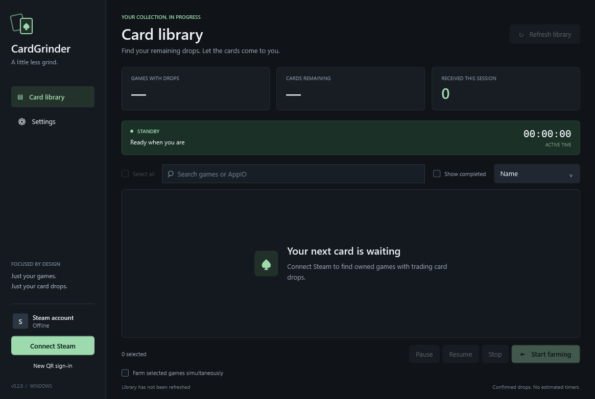

# CardGrinder

[](https://github.com/impatus/CardGrinder/actions/workflows/ci.yml)
[](LICENSE)

A focused Windows desktop application for the Steam trading card drops remaining in games you own. Built with C#, WPF, MVVM and SteamKit2. No browser wrapper, local web server or extra backend.

**[Download the Windows installer](https://github.com/impatus/CardGrinder/releases/latest/download/CardGrinder-Setup.exe)** · **[Portable ZIP](https://github.com/impatus/CardGrinder/releases/latest/download/CardGrinder-win-x64.zip)** · **[Releases and checksums](https://github.com/impatus/CardGrinder/releases)**

Windows 11 x64 is required. The installer includes the .NET 10 LTS runtime, runs without administrator rights, and adds a Start-menu entry, optional desktop shortcut and Windows uninstaller. Downloads are currently unsigned.



## Features

- QR/Steam Guard sign-in and automatic sign-in on later launches using an encrypted saved session.
- Owned games with remaining drops, covers, AppIDs, search and sorting.
- Select all, a single-game queue by default, and optional simultaneous farming of up to four games.
- Active games at the top, confirmed card progress, session totals and elapsed active time.
- Pause/Resume/Stop, tray controls and orderly shutdown.
- Bounded reconnection after temporary network/VPN interruptions, with card status checked before resuming.

## Getting started

1. Run **CardGrinder-Setup.exe**, or extract the complete portable ZIP.
2. Open CardGrinder and choose **Connect Steam**. Scan the QR code with the Steam mobile app and approve Steam Guard. Future launches restore the remembered session automatically while it remains valid.
3. Wait for the owned library and Badges pages to load. Requests are deliberately paced, so large libraries take longer.
4. Select games, or use **Select all**, then choose **Start farming**. One game at a time is recommended; simultaneous farming can reduce drop efficiency.
5. Use **Pause**, **Resume** or **Stop** as needed. Minimize to keep farming in the tray; closing the window or choosing Exit stops the connection.

Only games with drops appear by default. **Show completed** includes explicitly confirmed zero-drop games. Select all applies to eligible games in the current view. Farming requires an explicit start after application launch.

## Account data and network behavior

No password is collected. A remembered account name and refresh token are encrypted with Windows DPAPI for the current user at `%LOCALAPPDATA%\CardGrinder\session.bin`. Nonsecret preferences live alongside it in `settings.json`. **Sign out** removes the remembered session. Updates and uninstall/reinstall preserve local settings and remembered sessions; sign out first if you want the session removed.

There is no telemetry, analytics, crash upload, third-party backend, trading or Market automation. Runtime connections go to Steam infrastructure, Steam Community and Steam artwork hosts. A separate SteamKit2 connection reports selected AppIDs; game executables are never launched or modified. No code injection, achievement/stat modification, anti-cheat manipulation or game-server connection is implemented.

Card status is checked every three minutes while farming. Progress uses confirmed reductions in remaining drops, never a timer or predicted ETA. Steam can delay its own updates. Unknown/missing queued-game status pauses farming rather than assuming cards were received.

Temporary transport problems trigger at most five recovery attempts, delayed by 5, 15, 30, 60 and 120 seconds. A previously running queue resumes only after card verification; manually paused queues stay paused. Pause, Stop, Sign out and Exit cancel recovery. Conflicts with a normal playing session, authentication rejections, rate limits and changed Badges data require manual action.

## Limitations

Remaining drops are read from authenticated **Steam Badges HTML**, an undocumented surface that can change. SteamKit2 has no stable API for this data. Unknown responses stop the operation. Steam decides eligibility and timing, and no fixed drop rate is promised. The optional playtime preference rejects games under two recorded hours when waiting is disabled; this is not a guarantee of actual eligibility. Reported playtime can affect refund eligibility.

Valve alone decides whether third-party automation is permitted. CardGrinder makes no VAC-safety or risk-free guarantee and is not affiliated with Valve. QR login requires the Steam mobile authenticator.

## Build

Use Windows and the .NET SDK pinned in [global.json](global.json).

```powershell
dotnet restore CardGrinder.sln --locked-mode
dotnet build CardGrinder.sln -c Release --no-restore -m:1
dotnet test tests/CardGrinder.Tests/CardGrinder.Tests.csproj -c Release --no-build --no-restore
./scripts/build-release.ps1
```

Outputs are in `artifacts/release`: installer, portable ZIP and SHA-256 checksums. The build script verifies and installs the pinned Inno Setup compiler locally when needed. [Distribution instructions](docs/DISTRIBUTION.md) cover website hosting, installer verification and publishing releases.

The app also supports an offline visual check:

```powershell
./artifacts/CardGrinder-win-x64/CardGrinder.exe --smoke-test "$PWD/artifacts/ui-smoke"
```

It renders the disconnected dashboard, compact layout and settings without contacting Steam. The test suite uses offline fixtures, including a populated dashboard; there is no production demo account or fake card library.

## Project layout

| Directory | Purpose |
| --- | --- |
| `src/CardGrinder.Core` | Steam transport, encrypted storage, Badges parsing, request policy, farming/recovery |
| `src/CardGrinder` | WPF views, resources, view models, commands and tray/lifecycle |
| `tests/CardGrinder.Tests` | Offline queue, recovery, parsing, storage and UI tests |
| `installer` | Native Windows installer definition |
| `scripts` | Publishing, installer build and installation checks |
| `docs` | Technical notes, verification and distribution |

## Contributing and licensing

See [CONTRIBUTING.md](CONTRIBUTING.md), [SECURITY.md](SECURITY.md), [technical notes](docs/TECHNICAL-NOTES.md) and [verification](docs/VERIFICATION.md).

CardGrinder source is [MIT licensed](LICENSE). Third-party libraries retain their own licenses; in particular SteamKit2 is distributed separately under LGPL. Keep its replaceable DLL and all [third-party notices](THIRD-PARTY-NOTICES.md) with distributed builds.
